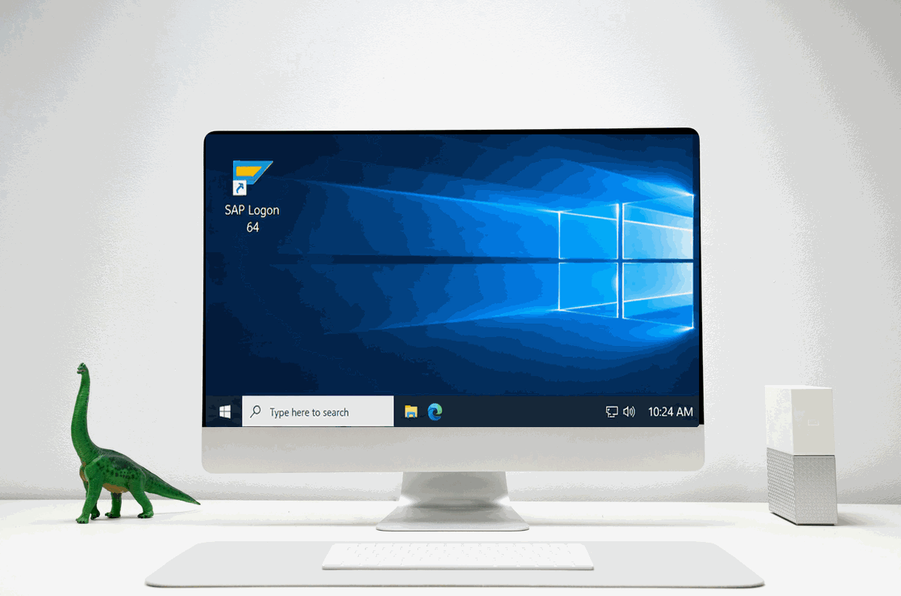

<!-- ## Hi there 👋 -->

<!--
**sohyunsapbc/sohyunsapbc** is a ✨ _special_ ✨ repository because its `README.md` (this file) appears on your GitHub profile.

Here are some ideas to get you started:

- 🔭 I’m currently working on ...
- 🌱 I’m currently learning ...
- 👯 I’m looking to collaborate on ...
- 🤔 I’m looking for help with ...
- 💬 Ask me about ...
- 📫 How to reach me: ...
- 😄 Pronouns: ...
- ⚡ Fun fact: ...
-->

  

## 🌿 About Me

Hi there 👋

I'm an SAP Basis Consultant. Since 2023, I've worked on a wide range of projects, from S/4HANA conversions and system migrations to day-to-day SAP operations and maintenance for clients across different industries.

To be honest, things don't always go as planned in SAP environments. Sometimes a simple task turns into hours of troubleshooting, and sometimes the fix is something you never would've expected.

I try to write down what I learn along the way, partly so my team can use it, and partly so I don't have to figure out the same thing twice. 😅

*Still learning, still troubleshooting, and hopefully getting a little better at both.*

## 🛠️ Tech Stack

**🧩 SAP Systems & Cloud**  
         

**🐧 Operating Systems**  
    

**🗄️ Databases**  
    

**⚙️ Programming & Scripting**  
    

## 📫 Contact

